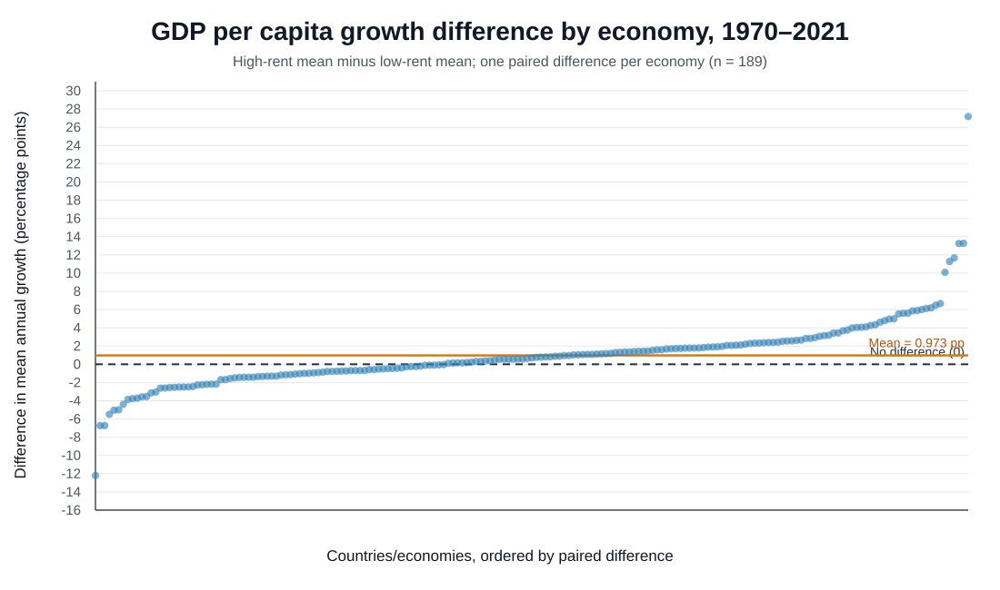
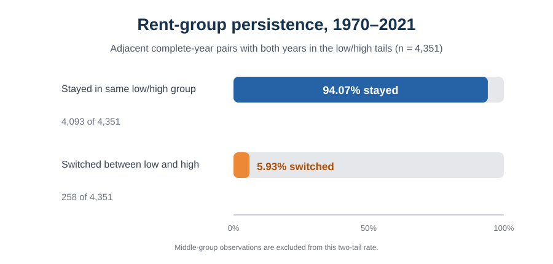

# Resource rents และการเติบโตของ GDP ต่อหัว

**คำถามหลัก:** ภายในประเทศ/เขตเศรษฐกิจเดียวกัน ช่วงที่ resource rents ค่อนข้างสูงมีการเติบโตของ GDP ต่อหัวแตกต่างจากช่วงที่ rents ค่อนข้างต่ำหรือไม่?

> **ผลเบื้องต้น:** ในช่วงข้อมูลร่วม 1970–2021 ค่าเฉลี่ย GDP per capita growth ช่วง rents สูงมากกว่าช่วง rents ต่ำ **0.973 จุดเปอร์เซ็นต์** จาก 189 คู่ประเทศ/เขตเศรษฐกิจ (paired t-test p = 0.000485; Wilcoxon signed-rank p = 0.000303) ผลนี้เป็นความสัมพันธ์ในข้อมูล ไม่ได้พิสูจน์ว่า rents เป็นสาเหตุให้เศรษฐกิจเติบโต

## ใช้ repository นี้

1. อ่านรายงานตามลำดับหัวข้อ 1–5
2. ดูกราฟผลต่างรายหน่วยและกราฟความต่อเนื่องของกลุ่ม rents ใน `results/figures/`
3. ใช้ [ตารางผลหลัก](results/analysis_summary.csv) และ [ผลรายประเทศ/เขตเศรษฐกิจ](results/country_pairs.csv)
4. รันโค้ดตาม [วิธีรัน](#วิธีรันโค้ด)

---

## 1. บทนำ

### ที่มาและความสำคัญ

ทรัพยากรธรรมชาติอาจเป็นแหล่งรายได้สำคัญและช่วยให้เศรษฐกิจเติบโต ขณะเดียวกันการพึ่งพาทรัพยากรอาจทำให้เศรษฐกิจผันผวนตามราคาสินค้าโภคภัณฑ์ โครงงานนี้จึงใช้ข้อมูล WDI ตรวจสอบว่า **ภายในหน่วยเศรษฐกิจเดิม** ปีที่ rents ค่อนข้างสูงเกิดพร้อมกับการเติบโตต่อหัวที่แตกต่างจากปีที่ rents ค่อนข้างต่ำหรือไม่

### Research Questions: คำถามที่โครงงานนี้ศึกษา

1. ภายในประเทศ/เขตเศรษฐกิจเดียวกัน การเติบโตของ GDP ต่อหัวในช่วงที่ resource rents อยู่ในกลุ่มสูงแตกต่างจากช่วงที่ rents อยู่ในกลุ่มต่ำหรือไม่?
2. โดยเฉลี่ยแล้ว ช่วง rents สูงและต่ำสัมพันธ์กับการเติบโตต่อหัวต่างกันในทิศทางใด และมีขนาดความแตกต่างเท่าใด?
3. ผลต่างระหว่างช่วง rents สูงกับต่ำมีทิศทางสอดคล้องกันมากน้อยเพียงใดในแต่ละประเทศ/เขตเศรษฐกิจ?
4. การจัดกลุ่ม rents ภายในหน่วยเศรษฐกิจเดิมต่อเนื่องระหว่างปีติดกันมากน้อยเพียงใด?
5. มีค่า rents หรือการเปลี่ยนแปลงรายปีขนาดใหญ่ที่ควรตรวจสอบเพิ่มเติมหรือไม่?

คำถามเหล่านี้ตั้งให้เป็นกลาง ไม่กำหนดล่วงหน้าว่าผลต่างจะเป็นบวก ลบ หรือไม่มีความแตกต่าง

---

## 2. สมมติฐาน ข้อมูล และขอบเขต

### สมมติฐานหลัก

ให้ `d_i` เป็นค่าเฉลี่ย GDP per capita growth ช่วง rents สูง ลบค่าเฉลี่ยช่วง rents ต่ำ ของประเทศ/เขตเศรษฐกิจหน่วยที่ `i`:

- `H₀: μ_d = 0` — ค่าเฉลี่ยผลต่างสูง−ต่ำเท่ากับศูนย์
- `H₁: μ_d ≠ 0` — ค่าเฉลี่ยผลต่างสูง−ต่ำไม่เท่ากับศูนย์

ทดสอบสองด้านที่ระดับนัยสำคัญ `α = 0.05`. หาก p-value ต่ำกว่า 0.05 จะปฏิเสธ `H₀` ภายใต้ข้อมูลและวิธีแบ่งกลุ่มนี้

### ตัวแปร

| ตัวแปร | ความหมาย | WDI series code |
|---|---|---|
| Total natural resources rents (% of GDP) | มูลค่า rents จากน้ำมัน ก๊าซ ถ่านหิน แร่ และป่าไม้ รวมกัน เทียบกับ GDP | `NY.GDP.TOTL.RT.ZS` |
| GDP per capita growth (annual %) | อัตราการเติบโตของ GDP ต่อคนในแต่ละปี | `NY.GDP.PCAP.KD.ZG` |

คำว่า **rents** ไม่ใช่มูลค่ายอดขายทรัพยากรทั้งหมด แต่เป็นค่าประมาณส่วนต่างระหว่างราคาสินค้าโภคภัณฑ์กับต้นทุนเฉลี่ยในการผลิต/สกัด คูณกับปริมาณที่ผลิตหรือเก็บเกี่ยว WDI รวม rents จากน้ำมัน ก๊าซธรรมชาติ ถ่านหิน แร่ และป่าไม้ และรายงานเป็นสัดส่วนของ GDP ([นิยามและวิธีคำนวณของ World Bank](https://databank.worldbank.org/metadataglossary/world-development-indicators/series/NY.GDP.TOTL.RT.ZS)).

### ขอบเขตและการเตรียมข้อมูล

- ใช้ World Development Indicators (WDI) ของ World Bank
- ช่วงหลักคือ **1970–2021** ซึ่งเป็นช่วงข้อมูลร่วมที่ยาวที่สุดของสองตัวแปรนี้; แม้ไฟล์ดาวน์โหลดมีหัวคอลัมน์ปี 1960–2025 แต่ rents มีข้อมูลอ้างอิงปี 1970–2021 ([หน้า rents](https://data.worldbank.org/indicator/NY.GDP.TOTL.RT.ZS?locations=1W), [หน้า GDP per capita growth](https://data.worldbank.org/indicator/NY.GDP.PCAP.KD.ZG)).
- หน่วยวิเคราะห์คือ country/economy-year. ใช้ Country Code และ Year รวมตัวแปร แล้วตัดแถวที่ขาดค่าอย่างน้อยหนึ่งตัวแปรออก โดยไม่เติมค่า missing
- ใช้ whitelist 217 ประเทศ/เขตเศรษฐกิจและตัดกลุ่มภูมิภาค/รายได้ออก
- ได้ 9,021 country-years ที่มีข้อมูลครบใน 212 หน่วย; ในจำนวนนี้ 189 หน่วยมีข้อมูลพอสร้างคู่สูง–ต่ำ
- เกณฑ์ rents ต่ำ/สูงคำนวณแยกภายในแต่ละประเทศ/เขตเศรษฐกิจ: ต่ำคือค่าไม่เกิน P33; สูงคือค่าไม่น้อยกว่า P67; ช่วงกลางไม่นำมาเทียบ
- ใช้ linear interpolation หา P33/P67 และต้องมีอย่างน้อย 3 ปีในแต่ละกลุ่ม หากจุดตัดเท่ากันจะแยกต่ำกับสูงไม่ได้ จึงตัดออก 23 หน่วย; 5 หน่วยไม่มีข้อมูลร่วม
- ทุกหน่วยที่เหลือให้หนึ่งคู่ค่าเฉลี่ยและหนึ่งผลต่าง จึงมี **189 คู่สำหรับการทดสอบ** และให้น้ำหนักแต่ละหน่วยเท่ากัน

### แยกจำนวนข้อมูลให้ชัด

- **9,021 country-years** คือจำนวนแถวประเทศ–ปีที่ใช้สร้างกลุ่มและคำนวณค่าเฉลี่ย
- **189 คู่** คือจำนวนผลต่างระดับประเทศ/เขตเศรษฐกิจที่นำเข้า paired t-test และ Wilcoxon

ดังนั้น observation ระดับปีที่มากขึ้นช่วยใช้ประวัติรายปีได้มากขึ้นในการคำนวณค่าเฉลี่ย แต่ไม่ได้ทำให้จำนวนคู่ทดสอบเพิ่มเป็น 9,021

---

## 3. ขั้นตอนการวิเคราะห์และสถิติทดสอบ

### หลักการจับคู่

หนึ่งคู่มาจากประเทศ/เขตเศรษฐกิจเดียวกัน: ค่าเฉลี่ย GDP per capita growth ในปีที่ rents ต่ำ และค่าเฉลี่ยในปีที่ rents สูง จากนั้นคำนวณผลต่างสูง−ต่ำ การจับคู่คือ **ประเทศเดิมเทียบกับตัวเอง** ไม่ใช่จับคู่ปีสูงกับปีต่ำให้เป็นปีปฏิทินเดียวกัน

### Paired t-test

คำนวณผลต่าง (d_i = \bar{Y}_{high,i} - \bar{Y}_{low,i}), ค่าเฉลี่ยผลต่าง \(\bar d\), ส่วนเบี่ยงเบนมาตรฐาน \(s_d\), และจำนวนคู่ \(n=189\):

```text
t = d̄ / (s_d / √n)
df = n − 1
95% CI = d̄ ± t(0.975, df) × s_d / √n
```

ใช้ทดสอบว่าค่าเฉลี่ยของผลต่างเท่ากับศูนย์หรือไม่ ข้อสมมติหลักคือผลต่างระหว่างหน่วยเป็นอิสระต่อกัน และการแจกแจงผลต่างไม่เบ้รุนแรงเกินไป

### Wilcoxon signed-rank

ใช้ตรวจสอบเสริมโดยจัดอันดับค่าสัมบูรณ์ของผลต่าง แล้วรวมอันดับของผลต่างบวกและลบ ไม่ต้องอาศัยสมมติฐานการแจกแจงปกติแบบเดียวกับ paired t-test แต่การตีความเป็นตำแหน่งรอบศูนย์อาศัยความเป็นอิสระและความสมมาตรโดยประมาณของผลต่าง

### ลำดับการทำงาน

1. เลือกสอง WDI series ตามรหัสตัวแปร
2. คัดประเทศ/เขตเศรษฐกิจใน whitelist และแปลงคอลัมน์ปีเป็นแถว country-year
3. รวมตัวแปรด้วย Country Code และ Year; แปลง `..` และค่าว่างเป็น missing; ไม่แทนค่าที่หาย
4. คำนวณ P33/P67 ภายในแต่ละหน่วยจากปีที่มีข้อมูลครบ แล้วหาค่าเฉลี่ย GDP per capita growth ของกลุ่มต่ำและกลุ่มสูง
5. คำนวณหนึ่งผลต่างต่อหน่วย และทดสอบด้วย paired t-test กับ Wilcoxon signed-rank สองด้าน
6. ตรวจการกระจายของค่า rents และการเปลี่ยนแปลงในปีติดกัน โดยทำเครื่องหมายค่าที่ควรตรวจสอบ ไม่ลบอัตโนมัติ

### โค้ดและวิธีรัน

ไฟล์หลัก [`analysis.py`](analysis.py); โค้ดตรวจค่าผิดปกติและความต่อเนื่องของ rents คือ [`audit_rents.py`](audit_rents.py).

```python
from scipy import stats

# หนึ่งผลต่างต่อประเทศ/เขตเศรษฐกิจ
differences = mean_growth_high - mean_growth_low

# paired t-test เทียบค่าเฉลี่ยผลต่างกับศูนย์
t_stat, p_value = stats.ttest_1samp(
    differences, popmean=0, alternative="two-sided"
)

# Wilcoxon signed-rank เป็นการตรวจสอบเสริม
w_stat, w_p_value = stats.wilcoxon(
    differences, alternative="two-sided", zero_method="wilcox"
)
```

```bash
python -m pip install -r requirements.txt
python analysis.py
python audit_rents.py
```

ผลลัพธ์จะอยู่ใน `results/`.

### กราฟผลต่าง

จุดหนึ่งจุดคือผลต่างสูง−ต่ำของหนึ่งประเทศ/เขตเศรษฐกิจ จุดเหนือเส้นศูนย์หมายถึงค่าเฉลี่ยการเติบโตช่วง rents สูงมากกว่า เส้นสีส้มคือค่าเฉลี่ยผลต่างจาก 189 คู่



### ตรวจ rents และการเปลี่ยนแปลงรายปี

ช่วง 1970–2021 มีค่า rents ที่ไม่หาย 9,235 country-years ใน 214 หน่วย ไม่พบค่าติดลบหรือค่าเกิน 100; ค่าสูงสุด 88.59% ของ GDP (Equatorial Guinea, 2000) และมี 108 ค่าเกิน 50% ของ GDP WDI ไม่ได้กำหนดว่าค่านี้ต้องอยู่ระหว่าง 0–100; การถูกทำเครื่องหมายด้วยเกณฑ์ Tukey จึงเป็นเพียงสัญญาณให้ตรวจ ไม่ใช่ข้อพิสูจน์ว่าข้อมูลผิด

ใน 189 หน่วย มีการเปลี่ยนจากปีหนึ่งไปปีถัดไปที่ข้อมูลครบ 8,100 ช่วง เมื่อทั้งสองปีอยู่กลุ่มต่ำหรือสูง มี 4,093 จาก 4,351 ช่วง (94.07%) ที่ยังอยู่กลุ่มปลายเดิม; 258 ช่วงเปลี่ยนระหว่างต่ำกับสูง มีการเปลี่ยน rents เกิน 20 จุดเปอร์เซ็นต์ 57 ครั้ง และเกิน 40 จุด 5 ครั้ง



ไฟล์ผู้สมัครที่ควรตรวจอยู่ใน `results/within_country_tukey_candidates.csv` และการเปลี่ยนแปลงรายปีที่มากที่สุดอยู่ใน `results/largest_adjacent_rent_changes.csv`. ไม่มีการลบค่าออกเพียงเพราะถูก flag. ไฟล์ตรวจผลรวม rents จากองค์ประกอบห้าหมวดใน `data/validation/` ครอบคลุมเฉพาะช่วง 2000–2021 และเป็นการตรวจความสอดคล้องภายในข้อมูล WDI เดียวกัน ไม่ใช่การยืนยันจากแหล่งอิสระ

---

## 4. ผลและการตีความ

ทดสอบสองด้านที่ระดับนัยสำคัญ 0.05

| คำถาม | ผล | ตีความ |
|---|---|---|
| 1. การเติบโตช่วง rents สูงกับต่ำต่างกันหรือไม่? | paired t-test: t(188) = 3.551, p = 0.000485; Wilcoxon: W = 6,257, p = 0.000303 | ทั้งสองวิธีพบหลักฐานว่าผลต่างโดยเฉลี่ยไม่อยู่ที่ศูนย์ ภายใต้ข้อสมมติของแต่ละวิธี |
| 2. ต่างกันทางไหนและมากเท่าไร? | ช่วงต่ำเฉลี่ย 1.519%; ช่วงสูง 2.491%; ผลต่างสูง−ต่ำ = **+0.973 จุดเปอร์เซ็นต์**; 95% CI [0.432, 1.513] | ในข้อมูลนี้ ช่วง rents สูงเกิดพร้อมกับการเติบโตต่อหัวเฉลี่ยที่สูงกว่า |
| 3. ทิศทางผลต่างสอดคล้องกันอย่างไร? | บวก 113 คู่; ลบ 76 คู่; ศูนย์ 0 คู่ จาก 189 คู่ | ผลต่างเป็นบวกในหน่วยส่วนใหญ่ แต่ไม่ใช่ทุกหน่วย |
| 4. กลุ่ม rents ต่อเนื่องระหว่างปีเพียงใด? | ในคู่ปีปลาย–ปลาย 4,093 จาก 4,351 ช่วง (94.07%) อยู่กลุ่มต่ำ/สูงเดิม | การจัดกลุ่มปลายค่อนข้างต่อเนื่องในปีติดกันที่เปรียบเทียบได้ |
| 5. มีค่าหรือการเปลี่ยนแปลงขนาดใหญ่ที่ควรตรวจไหม? | เกณฑ์ Tukey ภายในหน่วย flag 368 country-years ใน 115 หน่วย; rents เปลี่ยนเกิน 20 จุด 57 ครั้งและเกิน 40 จุด 5 ครั้ง | เป็นค่าที่ควรเปิดตรวจ; การ flag ไม่ได้แปลว่าเป็นข้อผิดพลาดโดยอัตโนมัติ |

**สรุปเบื้องต้น:** ในข้อมูล WDI ที่มีครบ ช่วง rents สูงสัมพันธ์กับค่าเฉลี่ยการเติบโต GDP ต่อหัวที่สูงกว่าในประเทศ/เขตเศรษฐกิจเดิม ผลนี้เป็นความสัมพันธ์เชิงสังเกต ไม่ได้พิสูจน์ว่า rents เป็นสาเหตุของการเติบโต

ไฟล์ผลหลัก: [ตารางสรุป](results/analysis_summary.csv), [ผลรายหน่วย](results/country_pairs.csv), [สรุปตรวจ rents](results/rent_diagnostics_summary.csv).

---

## 5. ข้อจำกัดและข้อเสนอแนะ

### ข้อจำกัด

- แม้มี 9,021 country-years แต่ paired tests ใช้ 189 ผลต่างระดับประเทศ/เขตเศรษฐกิจ ไม่ใช่ 9,021 หน่วยอิสระ การเพิ่มจำนวนปีช่วยคำนวณค่าเฉลี่ยจากช่วงยาวขึ้น แต่ไม่ได้เพิ่ม N ของ paired test
- 1970–2021 ครอบคลุมหลายยุคและเหตุการณ์เศรษฐกิจ ค่าเฉลี่ย rent สูงและต่ำอาจเกิดคนละช่วงเวลา และการทดสอบนี้ไม่ได้ควบคุมเหตุการณ์รายปีหรือปัจจัยที่เปลี่ยนตามเวลา
- P33/P67 วัดสูง/ต่ำเทียบกับประวัติของหน่วยนั้น ไม่ได้แปลว่าประเทศหนึ่งมีทรัพยากรมากกว่าอีกประเทศหนึ่ง และการตัดช่วงกลางทำให้บางข้อมูลไม่ได้ใช้
- WDI rents เป็นค่าประมาณจากราคา ต้นทุน และปริมาณ การตรวจในโครงงานนี้ช่วยชี้ค่าที่ควรตรวจ แต่ไม่ใช่การตรวจสอบกับแหล่งอิสระ
- รายชื่อประกอบด้วยประเทศ เขตเศรษฐกิจ และบางดินแดน จึงรายงานเป็น country/economy

### ข้อเสนอแนะ

1. ตรวจรายการ outlier candidates กับข้อมูลต้นทางของ World Bank ก่อนแก้หรือตัดค่า
2. ตรวจความไวต่อการแบ่งกลุ่ม เช่น P25/P75 หรือวิเคราะห์ rents แบบตัวเลขต่อเนื่อง
3. หากรายวิชาอนุญาต อาจต่อยอดด้วยแบบจำลองที่ควบคุม country และ year effects เพื่อพิจารณาเหตุการณ์ร่วมรายปี
4. ทุกครั้งที่รายงานผลให้แยกจำนวน country-years ออกจากจำนวนคู่ที่ใช้ทดสอบ และระบุ missing values

## ข้อมูลและแหล่งที่มา

- World Bank, WDI: [Total natural resources rents (% of GDP), NY.GDP.TOTL.RT.ZS](https://databank.worldbank.org/metadataglossary/world-development-indicators/series/NY.GDP.TOTL.RT.ZS)
- World Bank, WDI: [GDP per capita growth (annual %), NY.GDP.PCAP.KD.ZG](https://data.worldbank.org/indicator/NY.GDP.PCAP.KD.ZG)
- WDI ระบุ license ข้อมูลเป็น CC BY 4.0; โปรดอ้างอิง World Bank เมื่อนำข้อมูลหรือกราฟไปใช้ต่อ
